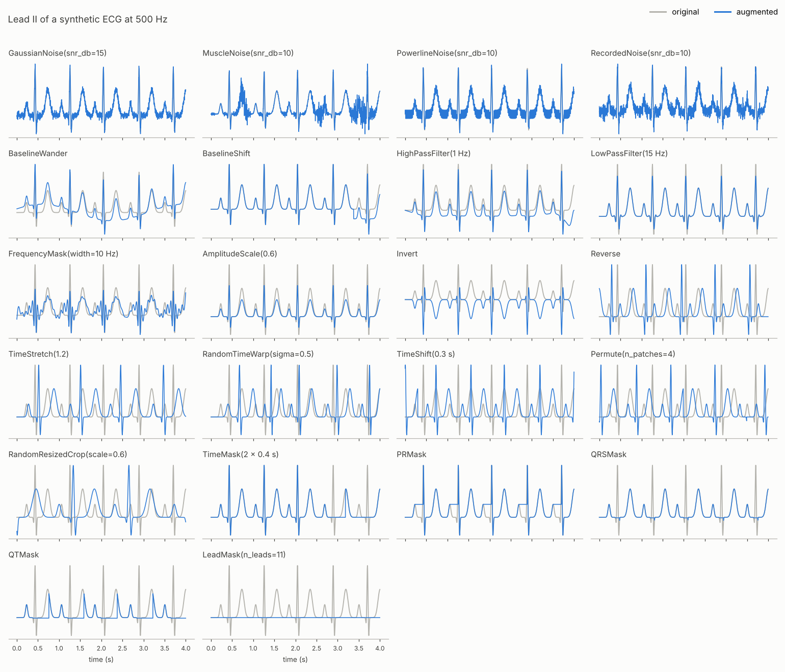

# ECG Augmentations

[](https://pypi.org/project/ecg-augmentations/)
[](https://github.com/klean2050/ecg-augmentations/actions/workflows/ci.yml)
[](LICENSE)
[](https://doi.org/10.5281/zenodo.8053042)

ECG signal augmentations for PyTorch, built for representation and self-supervised learning.

- Realistic noise and artifacts, amplitude, filtering, temporal and masking transforms.
- Single records, multi-lead records and batches, as PyTorch tensors or NumPy arrays, on CPU or GPU.
- Per-sample application probabilities and reproducible randomness through `torch.Generator`.



## Installation

```
pip install ecg-augmentations
```

Or install from source:

```
git clone https://github.com/klean2050/ecg-augmentations
pip install -e "ecg-augmentations[dev]"
```

The optional extras are `[peaks]` (neurokit2, for the default R-peak detector of `PRMask`, `QRSMask` and `QTMask`), `[examples]` (matplotlib) and `[dev]` (pytest, black).

## Quickstart

```python
import torch
import ecg_augmentations as ea

fs = 500
ecg, _ = ea.synthetic_ecg(duration=10, fs=fs, n_leads=12)  # (12, 5000)

augment = ea.Compose([
    ea.RandomCrop(duration=8, fs=fs),
    ea.BaselineWander(fs, amplitude=(0.05, 0.3), p=0.5),
    ea.GaussianNoise(snr_db=(15, 35), p=0.5),
    ea.PowerlineNoise(fs, freq=50, snr_db=(20, 40), p=0.3),
    ea.AmplitudeScale(scale=(0.8, 1.25), p=0.5),
    ea.OneOf([ea.TimeMask(fs, duration=(0.1, 0.5)), ea.LeadMask(n_leads=(1, 6))], p=0.5),
])

x = augment(ecg)                                        # (12, 4000)
views = ea.ComposeMany(augment, num_augmented_samples=2)(ecg)  # (2, 12, 4000)
x = augment(ecg, generator=torch.Generator().manual_seed(0))  # reproducible
```

See [`examples/ssl_views.py`](examples/ssl_views.py) for paired views with a `DataLoader`, and [`examples/plot_augmentations.py`](examples/plot_augmentations.py) for the figure above.

## Conventions

- **Shape.** Time is the last axis. Inputs can be `(T,)`, `(leads, T)` or `(batch, leads, T)`; transpose channel-last data first. The output has the same shape (except for crops), dtype, device and array type as the input, and the input is never modified.
- **Sampling rate.** Transforms with parameters in seconds or Hz take `fs` in Hz. There is no default, because a wrong `fs` silently produces wrong results.
- **Ranges.** A parameter given as `(low, high)` is sampled uniformly on every call; a scalar is a fixed value.
- **Probability.** Each transform has `p` (default 1). It is decided independently for every sample in a batch, as are all random parameters. `RandomApply(transforms, p)` gates a group and `OneOf(transforms)` picks one transform per sample.
- **Leads.** Timing is shared across leads: crops, shifts, stretching, warps, time masks and filter cutoffs. Additive noise is independent per lead. Per-lead transforms (`AmplitudeScale(per_lead=True)`, `LeadMask`, noise) break linear relations between leads, such as III = II − I.
- **Amplitude.** Noise is set by its SNR relative to each lead's signal power. Wander and baseline shifts are relative to each lead's standard deviation, or in signal units (e.g. mV) with `relative=False`.
- **Randomness.** Only the torch RNG is used. `torch.manual_seed` or a `generator=` argument make results reproducible, and DataLoader workers get distinct streams automatically.
- **Gradients.** Transforms are differentiable with respect to the input; masked samples receive zero gradient. R-peak detection runs on CPU.

## Transforms

| Transform | Key parameters (units) | Effect |
|---|---|---|
| `GaussianNoise` | `snr_db` (dB) | white noise per lead |
| `MuscleNoise` | `fs`, `snr_db` (dB), `band` (Hz), `bursts` | EMG-like band-limited noise, optionally bursty |
| `PowerlineNoise` | `fs`, `freq` (Hz), `snr_db` (dB), `harmonics` | mains interference with random phase per lead |
| `RecordedNoise` | `noise` array, `snr_db` (dB) | segments of recorded noise, e.g. MIT-BIH NSTDB `bw`, `em`, `ma` |
| `BaselineWander` | `fs`, `amplitude`, `freq` (Hz) | low-frequency drift |
| `BaselineShift` | `amplitude` | abrupt baseline step, as from electrode motion |
| `HighPassFilter` | `fs`, `cutoff` (Hz), `order` | zero-phase high-pass |
| `LowPassFilter` | `fs`, `cutoff` (Hz), `order` | zero-phase low-pass |
| `FrequencyMask` | `fs`, `width` (Hz), `n_masks`, `max_freq` (Hz) | removes random frequency bands |
| `AmplitudeScale` | `scale` (factor, log-uniform), `per_lead` | gain change |
| `Invert` | | polarity flip |
| `Reverse` | | time reversal |
| `TimeStretch` | `factor` | uniform tempo change, length kept |
| `RandomTimeWarp` | `sigma`, `n_knots` | smooth non-uniform tempo change |
| `TimeShift` | `fs`, `shift` (s), `circular` | delay or advance |
| `Permute` | `n_patches` | shuffles random segments |
| `RandomCrop` | `n_samples`, or `duration` (s) with `fs` | random fixed-length window |
| `RandomResizedCrop` | `n_samples`, `scale` (fraction) | random window resampled to a fixed length |
| `TimeMask` | `fs`, `duration` (s), `n_masks`, `fill` | masks time windows |
| `LeadMask` | `n_leads`, `fill` | masks whole leads, keeping at least one |
| `LeadSubset` | `subsets` (`"6"`, `"4"`, `"3"`, `"2"`, `"1"`) | keeps a random reduced lead set (12-lead input) |
| `VCGRotation` | `angle` (degrees), `scale` | rotates and scales the electrical axis in VCG space (12-lead input) |
| `DeriveLimbLeads` | | recomputes III, aVR, aVL, aVF from I and II (12-lead input) |
| `PRMask`, `QRSMask`, `QTMask` | `fs`, `ratio` (probability per beat), `detector` | masks the P wave/PR segment, QRS, or QRS-T |
| `Mixup`, `CutMix` | `alpha` | batch-level mixing of signals and float labels: `x, y = Mixup()(x, y)` |

Masks accept `return_mask=True` to also return the boolean mask, e.g. for masked-reconstruction objectives. The beat masks detect R peaks with neurokit2 by default. They also accept any `detector(signal, fs) -> peak_indices`. Their windows are approximate: 0.2 s before R; ±0.05 s; and from 0.05 s before R to 0.33 s after it at 60 bpm, scaled with the RR interval as sqrt(RR) (Bazett).

## 12-lead transforms

`VCGRotation`, `LeadSubset` and `DeriveLimbLeads` expect 12 leads in the order I, II, III, aVR, aVL, aVF, V1–V6 (`ea.LEADS`).

- `VCGRotation` maps leads I, II and V1–V6 to a vectorcardiogram with the Kors matrix, then rotates and scales it. It maps the result back, keeps the part of the signal the VCG does not capture, and rederives the remaining limb leads. Timing is unchanged and leads stay consistent. The idea follows 3KG (Gopal et al., 2021).
- `LeadSubset` simulates reduced-lead devices. Its lead sets follow the PhysioNet/CinC Challenge 2021 (6, 4, 3 and 2 leads), plus lead I alone (`ea.LEAD_SETS`).
- `DeriveLimbLeads` restores the relations III = II − I and aVR + aVL + aVF = 0 after per-lead transforms.

## Choosing augmentations

No augmentation is label-preserving for every task. Choose them by what your labels depend on.

| Transform | Morphology | Timing / heart rate | May invalidate |
|---|---|---|---|
| Noise (Gaussian, muscle, powerline, recorded) | preserved under the noise | preserved | at low SNR: P-wave-dependent labels (AF, AV block), small Q waves |
| `BaselineWander`, `BaselineShift` | preserved locally | preserved | ST deviation, if large relative to the ST level |
| `HighPassFilter` | ST/T distorted above ~0.5 Hz | preserved (zero-phase) | ST elevation/depression |
| `LowPassFilter`, `FrequencyMask` | QRS notches, Q waves and pacing spikes blunted | preserved | fragmented QRS, pacemaker detection |
| `AmplitudeScale` | shape preserved | preserved | voltage criteria (LVH, low voltage) |
| `AmplitudeScale(per_lead=True)`, `LeadMask`, `LeadSubset` | inter-lead relations broken or leads removed | preserved | axis, lead-localized findings (e.g. MI territory) |
| `VCGRotation` | lead amplitudes redistributed, leads kept consistent | preserved | axis deviation, lead-localized findings at large angles |
| `Invert` | polarity flipped | preserved | axis, T-wave inversion, Q waves, ST direction |
| `Reverse` | wave order reversed | RR sequence reversed | conduction (PR), most morphology labels |
| `TimeStretch`, `RandomTimeWarp`, `RandomResizedCrop` | intervals rescaled | heart rate, PR/QRS/QT changed | brady-/tachycardia, QT/QTc, QRS width (BBB) |
| `Permute`, circular `TimeShift`, `CutMix` | beats cut at boundaries | RR sequence altered | rhythm labels (AF, ectopy patterns) |
| `RandomCrop` | preserved | preserved | record-level labels of intermittent events |
| `TimeMask`, `PRMask`, `QRSMask`, `QTMask` | masked content removed | preserved | labels defined by the masked waves |

## Citation

```
@software{avramidis_kleanthis_2023_8053042,
    author = {Avramidis, Kleanthis},
    title = {ecg-augmentations},
    year = 2023,
    publisher = {Zenodo},
    doi = {10.5281/zenodo.8053042},
    url = {https://doi.org/10.5281/zenodo.8053042}
}
```
